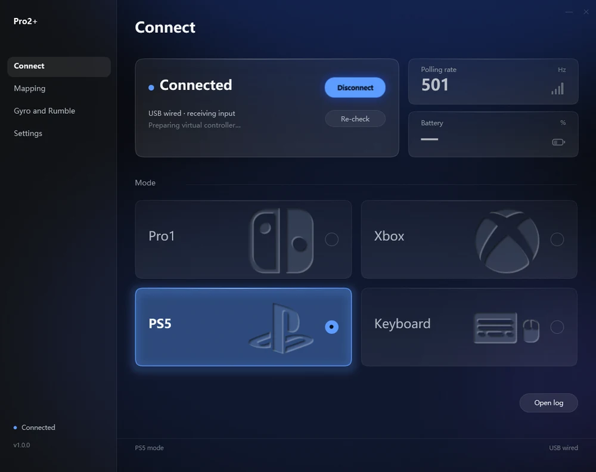
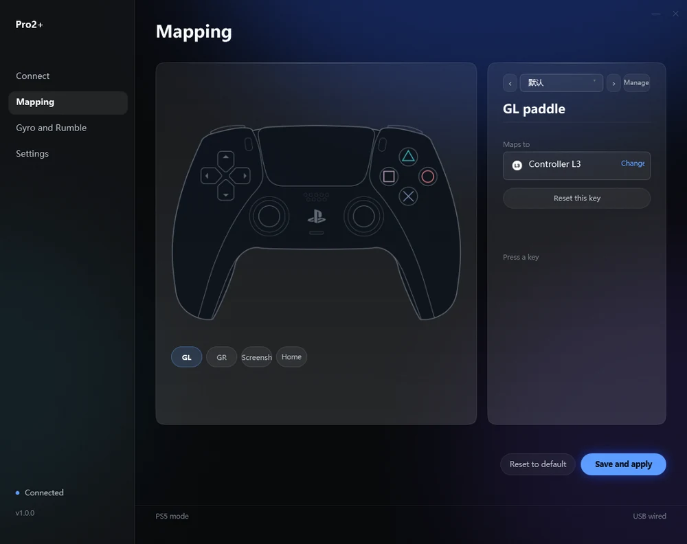
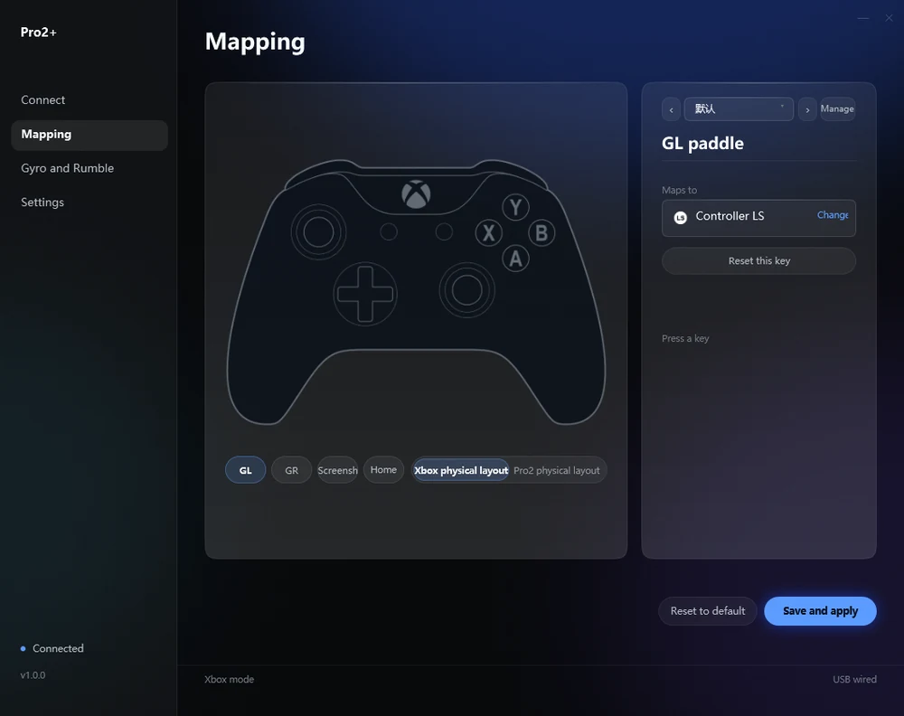
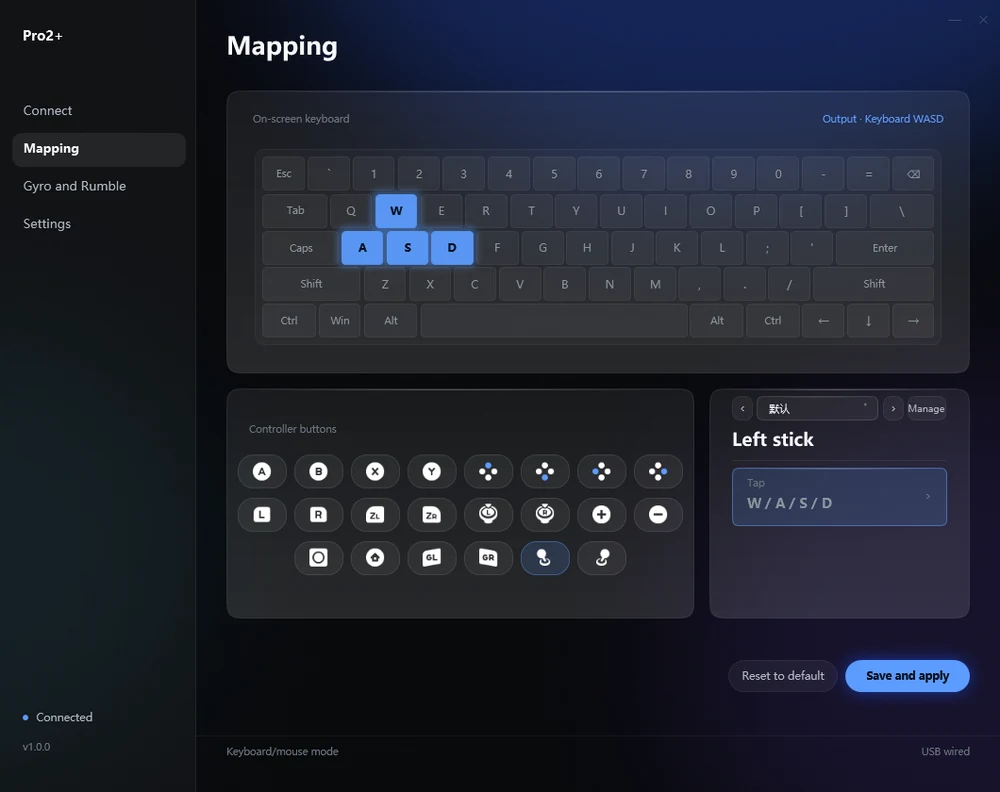

<p align="center">
  
</p>

<h1 align="center">Pro2+</h1>

<p align="center">
  Full-feature Windows companion for the Switch Pro2 controller<br>
  Wired 500 Hz · Bluetooth 125 Hz · Pro1 / Xbox / PS5 / keyboard-mouse output · Gyro to right stick or mouse
</p>

<p align="center">
  <b>English</b> · <a href="README.md">简体中文</a>
</p>

---

## 1. Download and run

**No runtime, no unzip — the links below are the exe itself. Download, double-click, done.**

| Build | Download | Size |
| :--: | :-- | :-- |
| English UI | **[⬇ Download Pro2+.exe](https://github.com/Zeul1o/Pro2Plus/releases/download/v1.0.0/Pro2Plus-1.0.0-en.exe)**<br><sub>Pro2Plus-1.0.0-en.exe</sub> | ~116 MB |
| 中文界面 | **[⬇ 下载中文版 Pro2+.exe](https://github.com/Zeul1o/Pro2Plus/releases/download/v1.0.0/Pro2Plus-1.0.0.exe)**<br><sub>Pro2Plus-1.0.0.exe</sub> | ~116 MB |

- On first launch it installs the **USBIP driver** once (the installer is embedded in the exe, no internet needed, one admin prompt). After that you are ready to go.

---

## 2. Pair the controller

**Bluetooth: click "Connect" in the app, then hold the Pro2 pairing button for 2 seconds and wait until the status reads "Connected".**

Wired: just plug in a USB-C cable — it is detected and connected automatically, no buttons needed.

| Connection | Polling rate |
| :-- | :-- |
| USB wired | **500 Hz** |
| Bluetooth | **125 Hz** |

---

## 3. Features

**Output modes and mapping**

| Feature | Details |
| :-- | :-- |
| **Four outputs: Pro1 / Xbox / PS5 / keyboard-mouse** | Turn the Pro2 into a Pro1 controller (Switch Pro compatible), an Xbox controller, a PS5 (DualSense) controller, or a full keyboard-mouse set — games see the device you choose |
| **Keyboard-mouse mapping** | Any controller button → keyboard key, left/right mouse button, mouse wheel; stick → WASD, with an on-screen keyboard preview |

**Motion (gyro)**

| Feature | Details |
| :-- | :-- |
| **Gyro to right stick** | Motion drives the right stick directly; sensitivity, horizontal/vertical multipliers, press multiplier and right-stick deadzone are adjustable |
| **Gyro to mouse** | Motion becomes mouse movement; max DPS, smoothing and deadzone are adjustable — built for shooters |
| **Native motion on PS5 / Pro1 output** | When emulating a PS5 or Pro1 controller the original gyro data is preserved, so in-game native motion just works with no extra mapping; sensitivity is tunable per output |

> Both gyro mappings (right stick and mouse) are toggled by the Pro2 **C button (chat button)**: press it once in-game to turn the mapping on, press again to turn it off — no need to alt-tab back to the app.

---

## 4. Screenshots

**Connect page**: plug in or pair and it shows "Connected", live polling rate, battery, and one-click switching between Pro1 / Xbox / PS5 / keyboard-mouse.



**Button mapping · PS5 layout**: the physical pad on the left, click any button and remap it on the right — GL / GR paddles, capture button and Home button included.



**Button mapping · Xbox layout**: ABXY can be swapped — output follows the letters printed on your pad, so Xbox and Pro2 physical layouts are both supported.



**Keyboard-mouse mapping**: controller buttons map one-to-one to keys, stick directions map to WASD, and the on-screen keyboard highlights the currently selected key.



---

## 5. Connection problems?

First check that the status dot in the bottom-left corner reads "Connected" and see which mode the status bar shows. If it still does not work, send the log in an issue and I will trace it:

1. Right-click the **Pro2+** tray icon → **"Export connection diagnostics…"**. This creates a `Pro2+-连接诊断回传-*.txt` file and selects it in Explorer.
2. Open **[New issue](https://github.com/Zeul1o/Pro2Plus/issues/new?template=connection-issue-en.md)** and drag that txt file straight into the text box to upload it.
3. Add one line about the connection type (wired / Bluetooth), the controller model and the game involved.

> The "Open log" button in the bottom-right corner of the connect page opens the log folder with the full daily log.

---

## 6. Build from source

Requires Windows 10 19041+ / Windows 11 and the .NET 8 SDK.

```powershell
git clone https://github.com/Zeul1o/Pro2Plus.git
cd Pro2Plus
# optional: drop in the third-party binaries listed below
powershell -ExecutionPolicy Bypass -File .\publish.ps1
```

Output: `dist\Pro2+.exe` (self-contained single file, double-click to run).

English UI build:

```powershell
powershell -ExecutionPolicy Bypass -File .\publish.ps1 -English
```

It copies `src\Pro2Plus` to `src\Pro2Plus.En`, replaces UI strings from `tools\en-strings.json` and builds
`dist\Pro2+-en.exe`. To add translations, edit that JSON — no source changes needed.

### Third-party binaries

The repository does not ship the following binaries; place them at the given paths for a complete build:

| Path | Purpose |
| --- | --- |
| `tools/viiper/haptic-v0.8.0/viiper-haptic-v2.8.exe` | Virtual controller and rumble passthrough |
| `tools/usbip-win2/v0.9.7.7/USBip-0.9.7.7-x64.exe` | Driver installer used by wired mode |

Without the driver installer you can build with `-p:EmbedUsbipInstaller=false`, but the resulting exe then expects the driver folder next to it.

---

## 7. Layout

```
src/Pro2Plus/     Windows app source (WPF, .NET 8)
  UI/                   Pages and views
  Connection/           USB / Bluetooth transport
  Mapping/              Button mapping and profiles
  Assets/               Icons, light effects, hint images
docs/                   Icon and UI screenshots
licenses/               Third-party licenses
publish.ps1             One-shot build
```

---

## 8. Credits

This project is based on [LeonChrome/XinHeLianSheng-Pro2-Bridge](https://github.com/LeonChrome/XinHeLianSheng-Pro2-Bridge) (Apache License 2.0) and carries over two chains from it:

- Bluetooth (BLE) input and connection tuning: device discovery, connection-parameter negotiation, 7.5 ms policy, rate diagnostics, battery and charge-state decoding
- Haptics and motion: DualSense HID haptic feedback, HD rumble passthrough, rumble queue and pacing, IMU motion pipeline

Those files are all modified from the originals (namespace changed from `Y700Switch2V60Viiper` to `Pro2Plus`, rewritten as needed); the change statement is in [`NOTICE`](NOTICE).

Third-party components: Viiper (GPL-3.0), usbip-win2 (BSD-2-Clause) and libusb (LGPL-2.1) — full texts in `licenses/`.

Viiper is distributed as a separate executable and launched by this program as a child process, communicating over a local port. It is neither linked nor combined with this project's source, so it is mere aggregation and does not affect the Apache-2.0 licensing of this project.

The bundled `viiper-haptic-v2.8.exe` is a modified build derived from VIIPER by the upstream project (SHA-256 `F434E356…7FEBFC`). Its corresponding source is the upstream repository's `source/final-three-in-one/tools/viiper/haptic-src` at tag `pro2-v3.2.7`; upstream VIIPER source: https://github.com/Alia5/VIIPER .

The upstream project is not affiliated with this one and does not endorse it.

---

## 9. License

Source code is released under the Apache License 2.0 — see `LICENSE`.

Bundled third-party components keep their own licenses: Viiper is GPL-3.0, usbip-win2 is BSD-2-Clause, libusb is LGPL-2.1; see `licenses/` for details.

libusb ships as an unmodified standalone DLL (`src/Pro2Plus/native/libusb-1.0.dll`) called via P/Invoke, and can be replaced with any compatible build. Its source: https://github.com/libusb/libusb .

`publish.ps1` copies `LICENSE`, `NOTICE` and `licenses/` into `dist/` — pass those files along whenever you share the exe.
