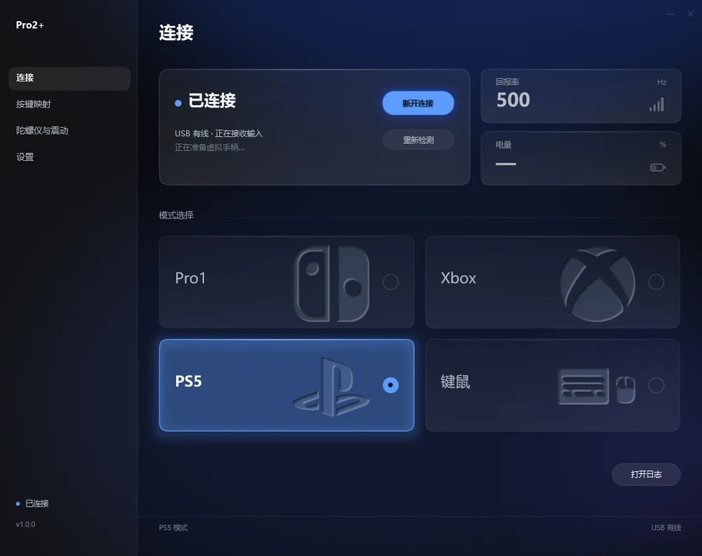
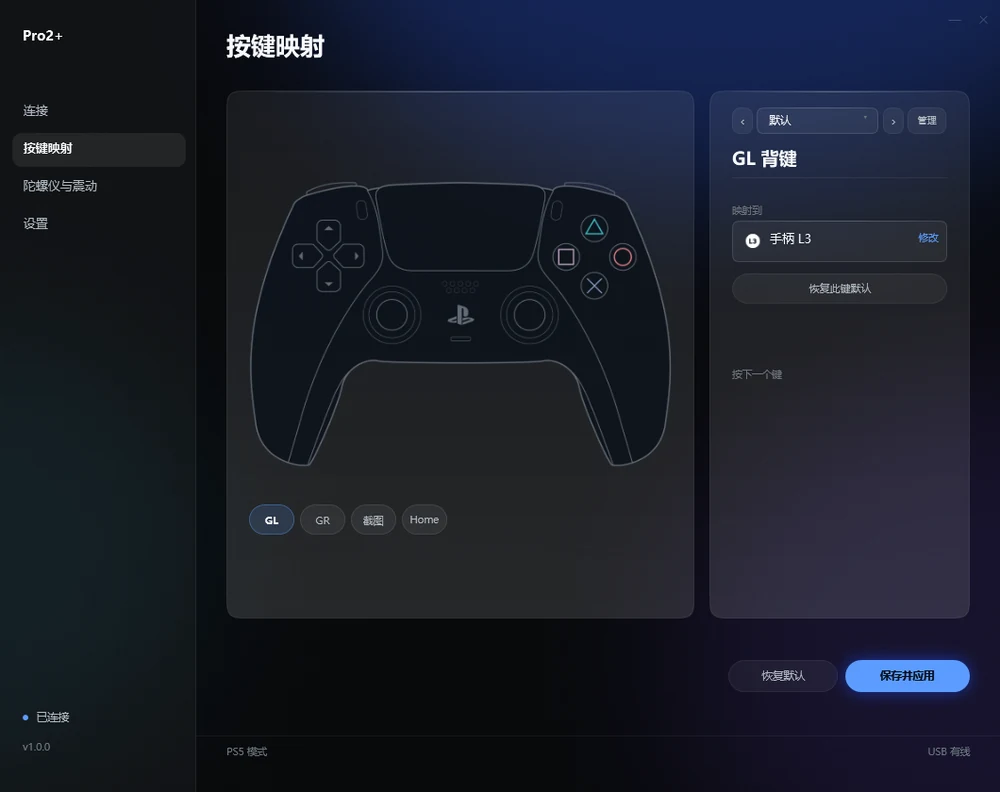
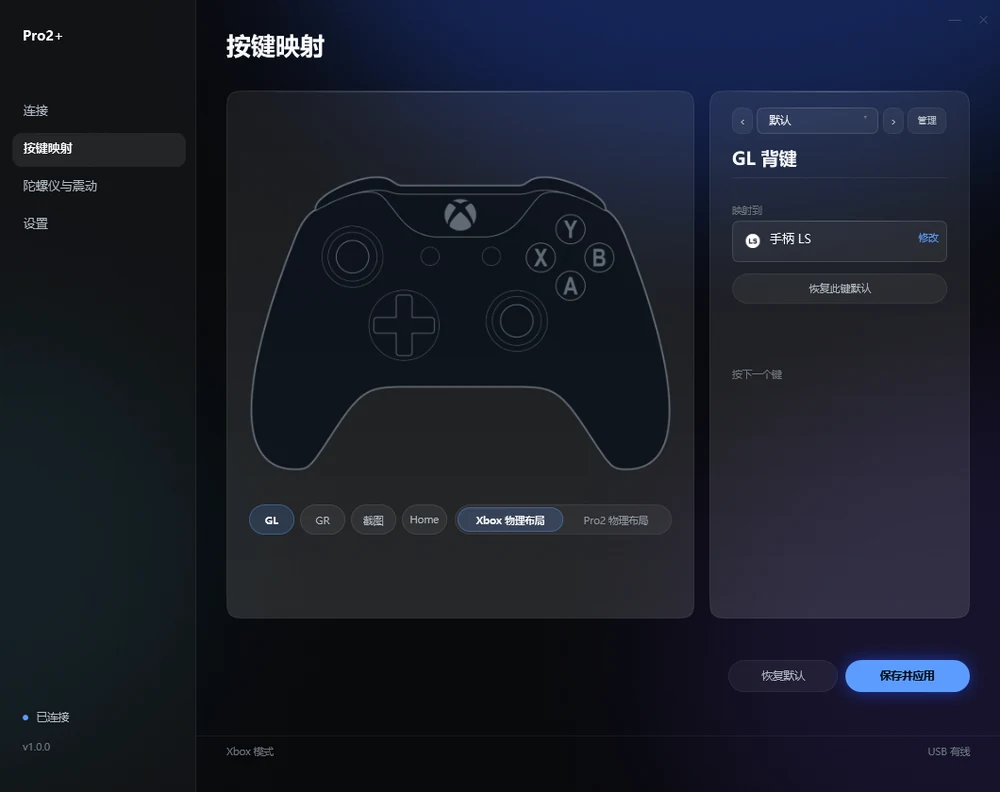
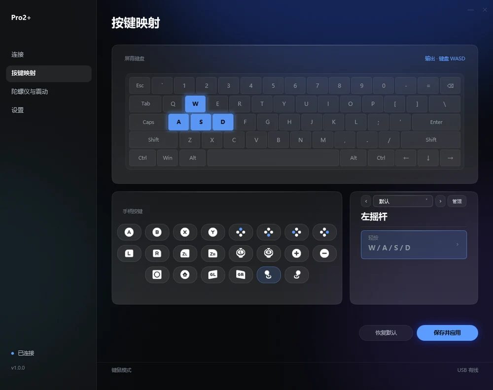

<p align="center">
  
</p>

<h1 align="center">Pro2+</h1>

<p align="center">
  Pro2 手柄 Windows 全功能适配<br>
  有线 500Hz · 蓝牙 125Hz · Pro1 / Xbox / PS5 / 键鼠 四种输出 · 陀螺仪映射右摇杆与鼠标
</p>

<p align="center">
  <b>简体中文</b> · <a href="README.en.md">English</a>
</p>

---

## 一、下载即用

**不用装环境、不用解压，点开下面链接就是 exe 文件，下载完双击运行。**

| 版本 | 下载 | 大小 |
| :--: | :-- | :-- |
| 中文版 | **[⬇ 点击下载 Pro2+.exe](https://github.com/Zeul1o/Pro2Plus/releases/download/v1.0.0/Pro2Plus-1.0.0.exe)**<br><sub>Pro2Plus-1.0.0.exe</sub> | 约 116 MB |
| English | **[⬇ Download Pro2+ (English UI)](https://github.com/Zeul1o/Pro2Plus/releases/download/v1.0.0/Pro2Plus-1.0.0-en.exe)**<br><sub>Pro2Plus-1.0.0-en.exe</sub> | 约 116 MB |

- 首次运行会装一次 **USBIP 驱动**（安装包已内置在 exe 里，不需要联网，会弹一次管理员确认），装完即可开始使用

---

## 二、连接手柄

**蓝牙：先点软件里的「连接」按钮，再长按 Pro2 手柄的配对键 2 秒，等状态变成「已连接」即可。**

有线：USB-C 线插上电脑就行，插上自动识别并连接，无需按任何键。

| 连接方式 | 回报率 |
| :-- | :-- |
| USB 有线 | **500 Hz** |
| 蓝牙 | **125 Hz** |

---

## 三、功能

**输出与映射**

| 能力 | 说明 |
| :-- | :-- |
| **Pro1 / Xbox / PS5 / 键鼠 四种输出** | 把 Pro2 变成 Pro1 手柄（Switch Pro 兼容）、Xbox 手柄、PS5（DualSense）手柄，或整套键鼠，游戏里按对应设备识别 |
| **键鼠映射** | 任意手柄按键 → 键盘按键、鼠标左/右键、滚轮；摇杆 → WASD，附带屏幕键盘可视化 |

**体感（陀螺仪）**

| 能力 | 说明 |
| :-- | :-- |
| **陀螺仪映射右摇杆** | 体感直接驱动右摇杆，可调灵敏度、水平/竖直倍率、下压倍率、右摇杆死区 |
| **陀螺仪映射鼠标** | 体感转鼠标移动，满速 DPS、平滑与死区可调，适合射击游戏 |
| **PS5 / Pro1 原生体感** | 走虚拟 PS5 / Pro1 输出时保留原生陀螺仪数据，游戏内原生体感直接可用，不需要额外映射，灵敏度可单独调 |

> 右摇杆和鼠标这两种体感映射，开关都绑在 Pro2 手柄的 **C 键（聊天键）** 上：进游戏后按一下 C 键开启，再按一下关闭，不用切回软件。

---

## 四、界面截图

**连接页**：插上线或连上蓝牙就显示「已连接」，实时回报率、电量，以及 Pro1 / Xbox / PS5 / 键鼠 四种模式一键切换。



**按键映射 · PS5 布局**：左侧是手柄实物图，点任意按键即可在右侧改映射，支持 GL / GR 背键、截图键、Home 键。



**按键映射 · Xbox 布局**：ABXY 支持对调——按手柄上丝印的字母输出，Xbox 与 Pro2 两种物理布局可以随时切换。



**键鼠映射**：手柄按键与键盘一一对应，摇杆推方向映射到 WASD，屏幕键盘同步显示当前选中的按键。



---

## 五、连接出问题了？

先看软件左下角的状态点是不是「已连接」、底部状态栏当前是什么模式；如果还是不行，把日志发到 Issue，我按日志定位：

1. 右键任务栏托盘里的 **Pro2+** 图标 → **「导出连接诊断…」**，会生成一个 `Pro2+-连接诊断回传-*.txt` 并自动在资源管理器里选中它
2. 打开 **[新建 Issue](https://github.com/Zeul1o/Pro2Plus/issues/new?template=connection-issue.md)**，把这个 txt 文件直接拖进输入框上传
3. 顺便写一句连接方式（有线 / 蓝牙）、手柄型号和出问题的游戏，方便对照

> 连接页右下角的「打开日志」可以直接打开日志目录，里面有当天的完整日志。

---

## 六、从源码构建

要求：Windows 10 19041+ / Windows 11，.NET 8 SDK。

```powershell
git clone https://github.com/Zeul1o/Pro2Plus.git
cd Pro2Plus
# 可选：放入第三方二进制（见下），再执行
powershell -ExecutionPolicy Bypass -File .\publish.ps1
```

产物：`dist\Pro2+.exe`（自包含单文件，双击即用）。

英文界面版：

```powershell
powershell -ExecutionPolicy Bypass -File .\publish.ps1 -English
```

它会把 `src\Pro2Plus` 复制成 `src\Pro2Plus.En`，按 `tools\en-strings.json` 替换界面文案后编译，
产物为 `dist\Pro2+-en.exe`。要补译词条，编辑该 JSON 即可，不需要改源码。

### 第三方二进制 / Third-party binaries

仓库不包含下列二进制文件，需要自行放到对应路径后才能完整构建：

| 路径 | 用途 |
| --- | --- |
| `tools/viiper/haptic-v0.8.0/viiper-haptic-v2.8.exe` | 虚拟手柄与震动回传 |
| `tools/usbip-win2/v0.9.7.7/USBip-0.9.7.7-x64.exe` | 有线模式的驱动安装包 |

缺少驱动安装包时可以加 `-p:EmbedUsbipInstaller=false` 构建，但生成的 exe 需要同级放置驱动目录。

---

## 七、目录 / Layout

```
src/Pro2Plus/     Windows 应用源码（WPF, .NET 8）
  UI/                   界面与页面
  Connection/           USB / 蓝牙连接
  Mapping/              按键映射与配置
  Assets/               图标、光效、提示图
docs/                   图标与界面截图
licenses/               第三方许可证
publish.ps1             一键打包
```

---

## 八、致谢 / Credits

本项目基于 [LeonChrome/XinHeLianSheng-Pro2-Bridge](https://github.com/LeonChrome/XinHeLianSheng-Pro2-Bridge)（Apache License 2.0）开发，沿用了以下两条链路：

- 蓝牙（BLE）输入链路与连接调优：设备发现、连接参数协商、7.5 ms 参数策略、速率诊断、电量与充电状态解码
- 触觉反馈与体感：DualSense HID 触觉反馈、HD 震动回传、震动队列与节拍、IMU 体感管道

第三方组件：Viiper（GPL-3.0）、usbip-win2（BSD-2-Clause）、libusb（LGPL-2.1），许可证原文见 `licenses/`。

Viiper 以独立可执行文件随包分发，由本程序以子进程方式启动、经本机端口通信，不与本项目源码链接或合并，属聚合分发，因此不影响本项目源码的 Apache-2.0 授权。Viiper 对应源码见 https://github.com/Alia5/VIIPER 。

上游项目与本项目无隶属关系，也未对本项目作任何背书。

---

## 九、许可证 / License

本项目源码基于 Apache License 2.0 发布，见 `LICENSE`。

内置的第三方组件遵循各自许可证：Viiper 为 GPL-3.0，usbip-win2 为 BSD-2-Clause，libusb 为 LGPL-2.1，详见 `licenses/`。

libusb 以未修改的独立 DLL（`src/Pro2Plus/native/libusb-1.0.dll`）随附，仅通过 P/Invoke 动态调用，可自行替换为其兼容版本。其源码见 https://github.com/libusb/libusb 。

打包时 `publish.ps1` 会把 `LICENSE`、`NOTICE` 与 `licenses/` 一并放进 `dist/`，转发 exe 时请连这些文件一起给出。
